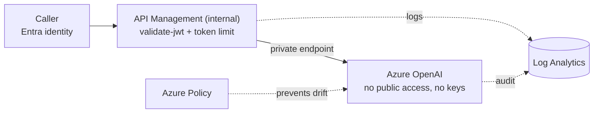

# Azure AI landing zone

[](https://github.com/darshansatpathy/azure-ai-landing-zone/actions/workflows/ci.yml)
[](https://github.com/darshansatpathy/azure-ai-landing-zone/actions/workflows/codeql.yml)
[](LICENSE)

A private, keyless place to run Azure OpenAI in a regulated organisation, written as
Terraform, plus the policy-as-code checker that stops anyone from quietly undoing it.

The design decision behind everything: **the model has no public address and no key.**
Callers authenticate to an API Management gateway with Microsoft Entra ID, the gateway gives
each caller a token budget, and the gateway alone talks to the model, over a private endpoint,
with a managed identity. Azure Policy then refuses any later change that reopens a door.



## What is in it

| Area | Contents |
|---|---|
| Modules | `network`, `observability`, `keyvault`, `openai`, `ai_gateway`, `guardrails` in `terraform/modules/` |
| Environments | `dev` and `prod` roots with identical code and different values (`terraform/envs/`) |
| State | `bootstrap` creates a locked, versioned state account with Entra ID auth |
| Checker | `tfpolicy`: 24 rules, reasoned suppressions, SARIF output, formatting check |
| Documentation | [Architecture](docs/architecture.md), [threat model](docs/threat-model.md), [compliance mapping](docs/compliance-mapping.md), [runbook](docs/runbook.md), [rules](docs/policies.md), [six ADRs](docs/adr) |
| Pipelines | CI with `terraform validate`, CodeQL, dependency audit; manual OIDC deploy with approvals |

## Try the checker

`tfpolicy` has no runtime dependencies and needs only Python 3.11 or later.

```bash
pip install -e ".[dev]"
tfpolicy check                       # 24 rules over terraform/
tfpolicy check --format markdown     # findings and every exception with its reason
tfpolicy check --format sarif --output tfpolicy.sarif
tfpolicy fmt-check terraform         # canonical formatting
tfpolicy rules                       # what is checked, and why
```

A finding names the file, line, severity, rule and resource (`tfpolicy rules` and
[docs/policies.md](docs/policies.md) give the rationale and the fix for each rule):

```text
main.tf:1: CRITICAL TFP001 public_network_access_enabled must be the literal false [azurerm_cognitive_account.this]
main.tf:1: HIGH TFP002 local_auth_enabled must be the literal false (Entra ID only) [azurerm_cognitive_account.this]
main.tf:1: HIGH TFP008 no private endpoint references azurerm_cognitive_account.this [azurerm_cognitive_account.this]
```

An exception is a comment with a mandatory reason. Without the reason it is itself a finding
(TFP000), so exceptions cannot be silent:

```hcl
# tfpolicy:ignore TFP008 reason="CI runners are public; the state account is firewalled and Entra-only"
resource "azurerm_storage_account" "state" { ... }
```

## Controls, in one table

| Concern | Control | Rules |
|---|---|---|
| Public exposure | Public access off, private endpoints, private DNS, no inbound-from-internet NSG rules | TFP001, 005, 007, 008, 013, 014, 021 |
| Identity | No API keys, Entra ID tokens, managed identity, RBAC everywhere, typed role assignments | TFP002, 003, 005, 020, 022 |
| Cost and abuse | Per-caller token limit at the gateway | TFP020 |
| Data protection | Purge protection, hardened storage, remote state | TFP004, 006, 017 |
| Auditability | Diagnostic settings to Log Analytics, required tags | TFP009, 015 |
| Supply chain | Version constraints, no credentials in code | TFP010, 012 |
| Drift | Azure Policy assigned in every environment | TFP018 |
| Correctness | References resolve, module calls match interfaces | TFP023, 024 |

The mapping to MCSB and ISO/IEC 27001 Annex A is in
[docs/compliance-mapping.md](docs/compliance-mapping.md). It is an audit aid, not a certification.

## Deploy

Read the [runbook](docs/runbook.md) first. In short:

```bash
cd terraform/bootstrap && terraform init && terraform apply -var-file=bootstrap.tfvars   # once
cd ../envs/dev
terraform init -backend-config=backend.hcl
terraform plan -var-file=dev.tfvars -out=plan.tfplan && terraform apply plan.tfplan
```

Use the **Deploy** workflow for anything shared. It uses OIDC, so there is no stored credential,
and the apply job waits for a reviewer.

## What has and has not been verified

I would rather say this plainly than leave it to be discovered.

- **Verified on every push:** ruff, `mypy --strict`, the test suite with an 85% coverage gate on
  Python 3.11 to 3.13, `tfpolicy check` and `fmt-check` on all Terraform, `terraform fmt -check`,
  `terraform init -backend=false` and `terraform validate` for every module and environment,
  CodeQL, and `pip-audit`.
- **Not exercised by CI:** `terraform plan` and `apply` against a real subscription. That needs
  your tenant, quota and network. The Deploy workflow does it, behind approval. Expect to
  adjust address spaces, regions, model names and DNS to your hub before the first real apply.
- **Checker limits:** `tfpolicy` parses the subset of HCL these modules use and reports a line
  number when it meets syntax it does not understand. It complements Checkov, tfsec or
  Conftest and does not replace Terraform's own validation ([ADR 0004](docs/adr/0004-own-policy-checker.md)).
- **Out of scope:** hub networking, firewall, multi-region traffic management, and prompt-level
  safety. The last is handled one layer up, by
  [agent-guardrails-gateway](https://github.com/darshansatpathy/agent-guardrails-gateway).

## Repository layout

```text
terraform/
  bootstrap/        remote state account (run once)
  modules/          network, observability, keyvault, openai, ai_gateway, guardrails
  envs/dev, prod    thin roots, identical code, different tfvars
src/tfpolicy/       the checker: hcl parser, engine, rules, fmt, report, cli
tests/              unit tests, mutation-style rule tests, repo-invariant tests
docs/               architecture, threat model, mapping, runbook, rules, ADRs
```

## Contributing and security

See [CONTRIBUTING.md](CONTRIBUTING.md) and [SECURITY.md](SECURITY.md). Changes are recorded in
[CHANGELOG.md](CHANGELOG.md). Licensed under the [MIT License](LICENSE).
