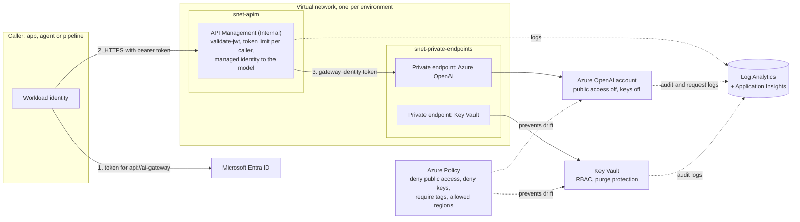

# Architecture

One resource group per environment holds a private network, a model account, a gateway in
front of it, a vault and the logging that records all of it. Nothing in the data path has a
public address, and nothing authenticates with a key.

## Layout

| Path | Purpose |
|---|---|
| `terraform/bootstrap` | Remote state storage. Run once per subscription. |
| `terraform/modules/network` | Virtual network, one NSG per subnet, private DNS zones and links. |
| `terraform/modules/observability` | Log Analytics workspace and Application Insights. |
| `terraform/modules/keyvault` | Key Vault with RBAC, purge protection, private endpoint and audit logs. |
| `terraform/modules/openai` | Azure OpenAI account, deployments, private endpoint, logs and role assignments. |
| `terraform/modules/ai_gateway` | API Management in internal mode, the gateway policy, NSG rules and private DNS. |
| `terraform/modules/guardrails` | Azure Policy definitions and assignments that stop drift from the above. |
| `terraform/envs/dev`, `prod` | Environment roots. Same code, different values. |
| `src/tfpolicy` | The policy checker that gates every change. |

## How a request is handled

1. The caller gets a token from Microsoft Entra ID for the gateway's audience.
2. The gateway validates the token, then charges the request against that caller's token
   budget (`llm-token-limit`). A caller over budget gets a 429 and nobody else is affected.
3. The gateway swaps the caller's token for its own managed-identity token and forwards the
   request over the private endpoint. The model account has no key to steal and no public
   address to reach.
4. Every call is logged by the gateway, and the account writes its own audit log, both to
   Log Analytics with 90 to 180 days of retention.

## Two layers keep it this way

Terraform closes the doors. **Azure Policy** then refuses any later change that reopens them,
for example someone enabling public access in the portal. `tfpolicy` checks the same
invariants in the code before it is ever applied, so a bad change fails in the pull request
rather than at deployment. See [ADR 0005](adr/0005-two-layers-of-enforcement.md).

## What is deliberately not here

- **A hub network, firewall or ExpressRoute.** This is a spoke. Peer it into your hub and
  point DNS at your resolver.
- **Multi-region.** API Management Premium supports additional regions and the model account
  can be deployed twice behind the gateway; the runbook describes the steps.
- **Model deployments.** Models and quota differ by region and change often, so they are
  inputs (`deployments`), not defaults.
